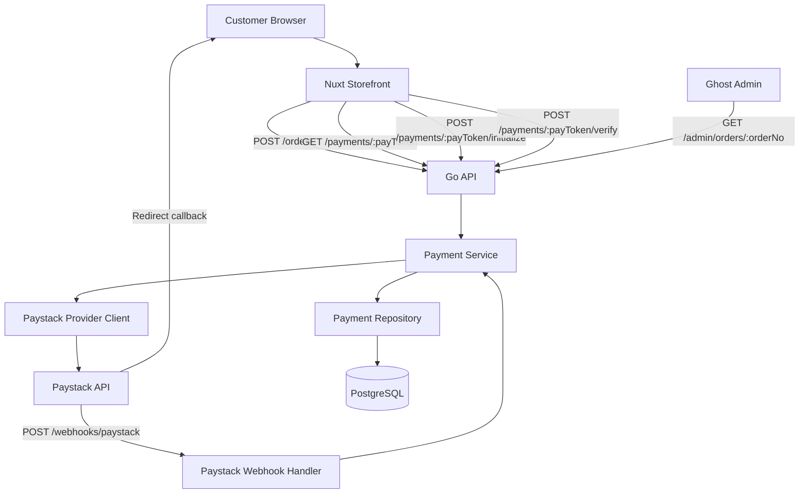
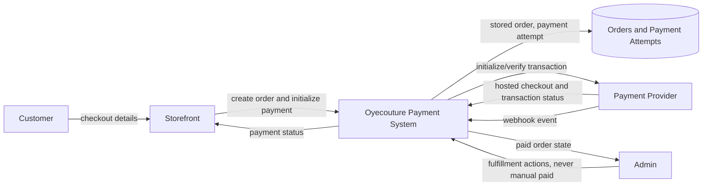
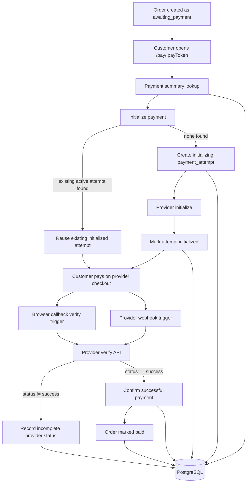
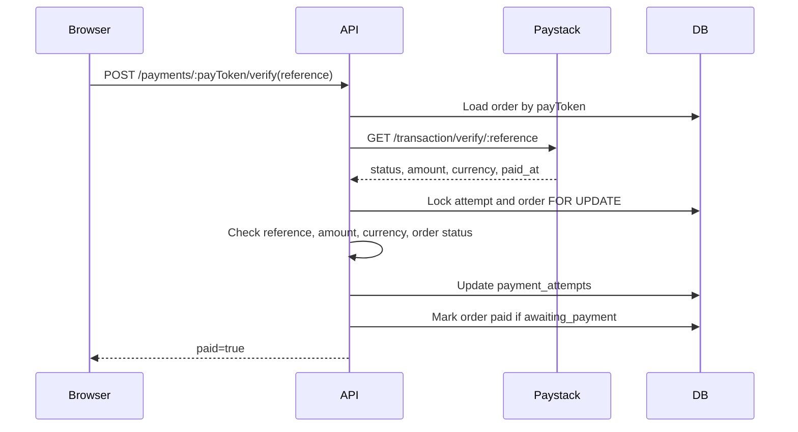
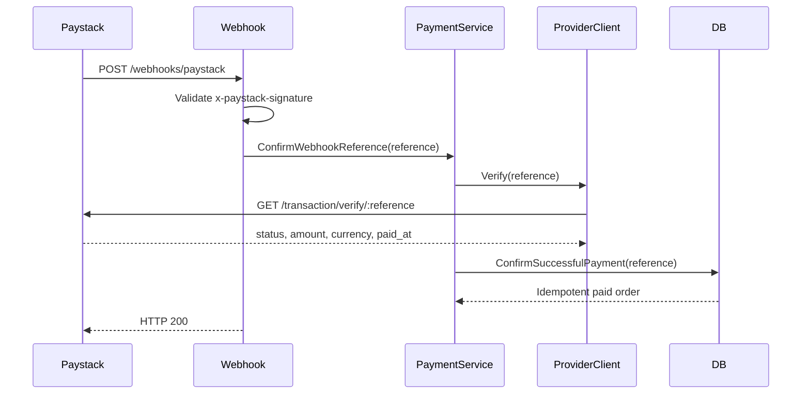
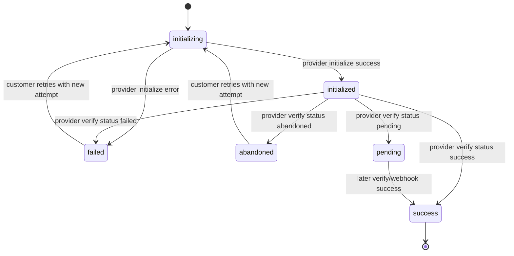
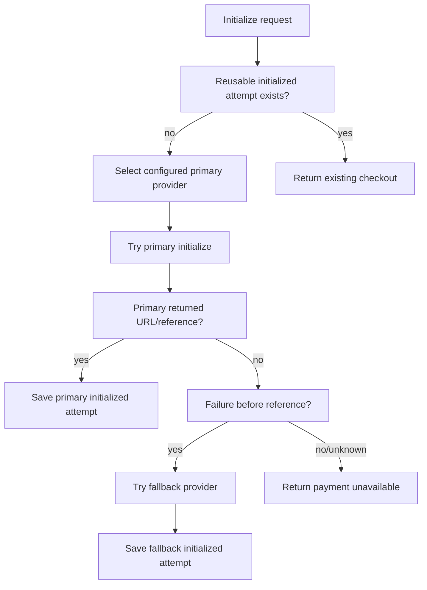

# Payment System Architecture

Last updated: 2026-08-02

## Purpose

This document describes the Oyecouture payment system architecture, data flow, provider boundaries, idempotency controls, verification checks, and provider fallback strategy.

The current active provider is Paystack. Nomba is reserved as a later provider behind the same internal provider interface.

## Goals

- Never mark an order as paid from browser input alone.
- Never trust provider redirects without server-side verification.
- Keep money as integer kobo end to end.
- Allow customers to recover from refreshes, retries, and duplicate clicks.
- Prevent duplicate Paystack checkout sessions for the same unpaid order.
- Make webhook and callback confirmation idempotent.
- Keep provider-specific code isolated so another provider can be added without rewriting payment orchestration.

## Current Source Layout

```text
api/internal/payments/
  handler.go                generic public payment HTTP routes
  model.go                  shared payment models, statuses, errors
  provider.go               shared provider interface
  repository.go             payment_attempts and order settlement persistence
  service.go                payment orchestration and verification logic
  service_test.go           provider-agnostic service tests
  paystack/
    provider.go             Paystack initialize and verify API client
    webhook.go              Paystack webhook signature validation and handler
    webhook_test.go         Paystack signature tests
  nomba/
    .gitkeep                reserved provider folder
```

## Current Runtime Components



## Data Flow Diagram - Level 0



## Data Flow Diagram - Level 1



## Payment Lifecycle

### 1. Order Creation

Ready-to-wear checkout creates an order with:

- `orders.status = awaiting_payment`
- `orders.total_kobo` calculated server-side
- `orders.pay_token` used for the public payment link

The customer is redirected to:

```text
/pay/<payToken>
```

### 2. Payment Summary

The storefront calls:

```text
GET /payments/{payToken}
```

The API returns the order summary, items, total, and whether the order is payable.

Payable means:

```text
orders.status == awaiting_payment
```

### 3. Initialize Hosted Checkout

The storefront calls:

```text
POST /payments/{payToken}/initialize
```

The service checks:

- provider is configured
- order exists
- order is not already `paid`
- order is exactly `awaiting_payment`
- reusable initialized attempt exists for same order/provider/amount/currency

If a reusable attempt exists, the API returns the existing Paystack `authorization_url`, `access_code`, and `reference`.

If no reusable attempt exists:

1. Generate reference:

   ```text
   <ORDER_NO>-<random_hex>
   ```

2. Insert `payment_attempts` row:

   ```text
   status = initializing
   provider = paystack
   amount_kobo = order.total_kobo
   currency = NGN
   ```

3. Call Paystack initialize.
4. Validate Paystack returned the same reference.
5. Mark attempt:

   ```text
   status = initialized
   authorization_url = provider authorization URL
   access_code = provider access code
   provider_payload = raw Paystack response
   ```

## Confirmation Strategy

Payment confirmation has two triggers, but one source of truth.

### Triggers

1. Browser callback:

   ```text
   /pay/:payToken/callback?reference=<reference>
   ```

   The frontend calls:

   ```text
   POST /payments/{payToken}/verify
   ```

2. Paystack webhook:

   ```text
   POST /webhooks/paystack
   ```

### Source Of Truth

Both triggers call Paystack verify from the backend.

The browser callback and webhook event are never enough by themselves. They only tell the system to verify the reference.





## Payment Attempt Table

The `payment_attempts` table stores the provider transaction lifecycle.

Important fields:

| Field | Purpose |
| --- | --- |
| `order_id` | Links attempt to the order |
| `provider` | `paystack`, later `nomba`, etc. |
| `reference` | Unique provider reference generated by our system |
| `amount_kobo` | Amount submitted to provider |
| `currency` | Current expected value: `NGN` |
| `status` | Local/provider attempt status |
| `authorization_url` | Hosted checkout URL |
| `access_code` | Paystack checkout access code |
| `provider_payload` | Raw provider response for audit/reconciliation |
| `verified_at` | When provider verification was recorded |
| `paid_at` | Provider paid timestamp when available |

Important constraints and indexes:

- `reference` is unique.
- `amount_kobo > 0`.
- `provider`, `reference`, `currency`, `status` must not be empty.
- `payment_attempts_one_initialized_attempt_per_order_idx` permits only one `initialized` attempt per order.

## Attempt Status Model



Note: Paystack can return statuses such as `success`, `failed`, `abandoned`, or `pending`. We store the provider status for non-success verification results.

## Checks Before Initializing Payment

The payment service checks:

- configured provider exists
- order exists for `payToken`
- order is not already `paid`
- order status is `awaiting_payment`
- matching initialized attempt already exists for:
  - same order
  - same provider
  - same amount
  - same currency
  - non-empty authorization URL

If a match exists, it is reused.

## Checks Before Confirming Payment

The confirmation path checks:

- provider verify API returned the same reference requested
- transaction status is `success`
- payment attempt exists
- browser callback reference belongs to the same order as the `payToken`
- webhook signature is valid before webhook processing
- attempt amount equals Paystack amount
- order total equals Paystack amount
- attempt currency equals provider currency
- provider currency is `NGN`
- order is either:
  - `awaiting_payment`, then it can be marked paid
  - already `paid`, then confirmation returns idempotently

Admin users cannot manually mark an order `paid`; paid status is reserved for server-side payment verification.

## Idempotency Design

Idempotency is handled in three layers.

### 1. Initialize Idempotency

Normal repeat clicks:

- API searches for an existing initialized attempt.
- If found, it returns the existing `authorization_url`, `access_code`, and `reference`.
- It does not create another Paystack checkout session.

Concurrent clicks:

- Two requests may both try to initialize.
- The partial unique index allows only one row to become `initialized`.
- The losing attempt is marked `failed`.
- The loser then fetches and returns the surviving initialized attempt.

Result:

```text
same unpaid order + repeated Pay clicks = same checkout reference and URL
```

### 2. Reference Idempotency

Each attempt reference is unique:

```text
payment_attempts.reference UNIQUE
```

This prevents accidental reuse of a provider reference across attempts.

### 3. Settlement Idempotency

Successful confirmation happens inside a database transaction:

```sql
FOR UPDATE OF payment_attempts, orders
```

The locked confirmation flow:

1. Load attempt and order by reference.
2. Verify amount and currency.
3. Update the attempt to `success`.
4. If order is already `paid`, commit and return.
5. If order is `awaiting_payment`, update order to `paid`.
6. If order is any other status, reject as not payable.

Result:

```text
multiple callback/webhook deliveries = one paid order settlement
```

## Provider Fallback Design

The code is structured for provider fallback through:

```go
type Provider interface {
    Name() string
    Initialize(context.Context, InitializeRequest) (InitializeResult, []byte, error)
    Verify(context.Context, string) (Verification, error)
}
```

Current provider:

```text
PAYMENT_PROVIDER=paystack
```

Reserved future provider:

```text
api/internal/payments/nomba/
```

### Recommended Fallback Policy

Provider fallback must be conservative because automatic retries can create duplicate charges.

Allowed fallback cases:

- selected provider is unavailable before any local attempt is created
- selected provider initialize fails before returning a checkout URL/reference
- operational provider switch for new orders only

Disallowed automatic fallback cases:

- customer already received a provider checkout URL
- provider returned a reference but the browser failed
- provider verify is temporarily unavailable
- webhook delivery is delayed
- status is unknown or pending

In unknown states, the system should verify/reconcile with the same provider instead of trying another provider.

### Fallback Flow For Future Implementation



### Provider Fallback Invariants

- A provider reference belongs to exactly one attempt.
- Once a customer receives a checkout URL, all verification for that reference must stay with that provider.
- Do not switch provider during verification.
- Do not retry a successful charge with another provider.
- Fallback provider attempts must write their own `provider`, `reference`, `amount_kobo`, and `currency`.
- Admin UI should show provider and reference for reconciliation.

## Webhook Security

Paystack webhook handling:

- reads the raw request body
- validates `x-paystack-signature`
- signature is HMAC SHA512 using the Paystack secret key
- rejects missing/invalid signature
- processes `charge.success` only when reference exists
- still calls Paystack verify before confirming payment

Local caveat:

```text
Paystack cannot deliver real webhooks to localhost.
```

For local development, callback verification can confirm sandbox payments. Production webhook testing requires public HTTPS or a secure tunnel.

## Failure And Recovery Scenarios

| Scenario | Expected behavior |
| --- | --- |
| Customer refreshes `/pay/:token` | Payment summary reloads from order state |
| Customer clicks Pay repeatedly | Existing initialized attempt is reused |
| Two initialize calls race | One initialized attempt survives; loser returns winner |
| Paystack redirects but webhook is delayed | Callback verify can mark paid |
| Browser closes after paying | Webhook can mark paid later |
| Webhook arrives twice | Settlement is idempotent |
| Callback verify arrives after webhook | Settlement returns already paid order |
| Paystack verify returns pending/abandoned | Attempt status is recorded; order remains unpaid |
| Amount mismatch | Confirmation is rejected |
| Currency mismatch | Confirmation is rejected |
| Reference belongs to another order in browser callback | Confirmation is rejected |
| Admin tries to mark paid manually | Not allowed |

## Operational Reconciliation

The system stores raw provider payloads on `payment_attempts.provider_payload`. This supports:

- debugging Paystack status differences
- reconciling successful provider payments with local order status
- auditing failed or abandoned attempts
- future admin payment timeline views

Recommended later additions:

- admin payment attempts panel on order detail
- scheduled reconciliation job for initialized/pending attempts
- explicit attempt expiry based on provider behavior
- refund tracking table if refund workflows become active
- alerting for amount/currency mismatch or verify failures

## Launch Checklist

- `PAYMENT_PROVIDER=paystack`
- `PAYSTACK_SECRET_KEY` set in production secret storage
- no secret committed to Git
- production `WEB_BASE_URL` set to public HTTPS URL
- `POST /webhooks/paystack` registered in Paystack dashboard
- webhook signature validation tested from Paystack dashboard
- sandbox success, failed, abandoned, and duplicate-click flows tested
- admin order detail confirms paid state after callback and webhook
- provider reconciliation process documented for support

## Current Known Limits

- Paystack is the only implemented provider.
- Nomba folder exists for future provider implementation.
- Provider fallback is architectural, not automatic live failover yet.
- Webhooks need public HTTPS and cannot be fully tested against `localhost`.
- Payment attempt expiry is not yet modeled; initialized attempts are reused until they become terminal or are reconciled.
